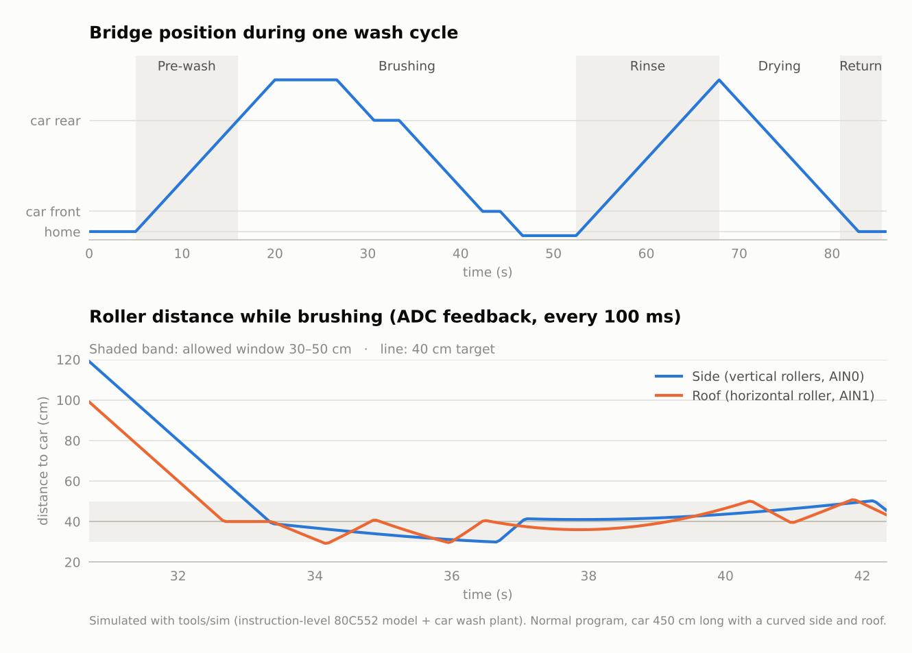
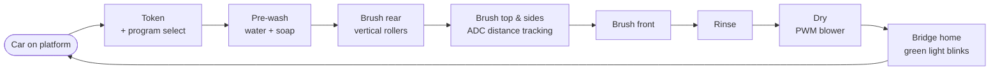
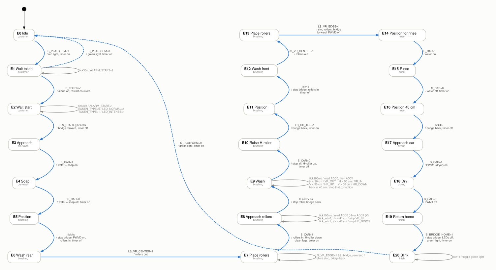
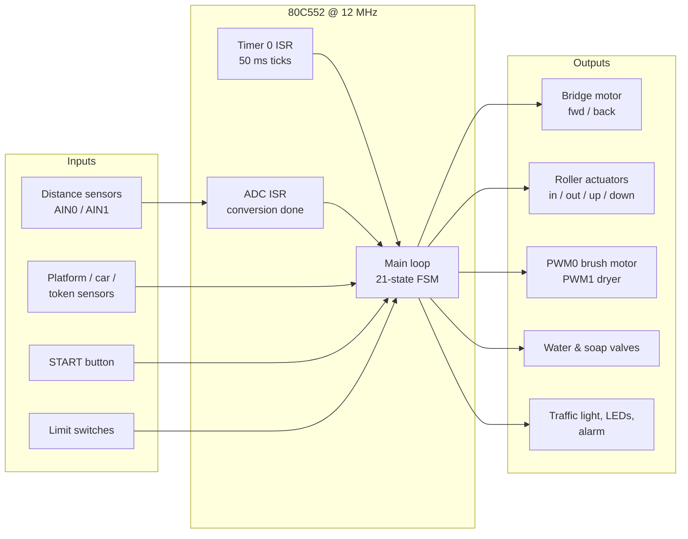

<div align="center">

# Car Wash Tunnel Controller — 8051 Assembly

**Real-time embedded controller for a fully automatic car wash, written from scratch in
8051 assembly for the Philips/NXP 80C552 microcontroller.**


[](https://github.com/Ando144/embedded-carwash-controller-8051/actions/workflows/firmware-tests.yml)
[](LICENSE)

</div>

---

## Overview

The firmware runs a complete drive-through car wash: it detects the car, takes a token, lets the
driver choose a **normal** or **intense** program, and then drives a moving gantry ("bridge")
through **pre-wash → brushing → rinsing → drying**, before sending the bridge home and releasing
the car.

During brushing the rollers are kept at a constant distance from the bodywork using two analog
distance sensors, so the system adapts to the shape of each car in real time.

Everything runs on an 8-bit 8051 core at 12 MHz with **no operating system and no C runtime**:
about 1,300 lines of hand-written assembly built on interrupts, jump tables and on-chip
peripherals. A custom **instruction-level simulator** runs the same source in CI, so every
change is tested against a full wash cycle.

<picture>
  <source media="(prefers-color-scheme: dark)" srcset="docs/img/wash_cycle_dark.png">
  
</picture>

<sub>One wash cycle, produced by the simulator in <code>tools/sim</code> running the real firmware.</sub>

## Highlights

| | |
|---|---|
| **21-state finite state machine** | Table-driven design: every state is an *event generator* plus an *action table*, both dispatched in constant time with `JMP @A+DPTR`. Adding or changing a state means editing a single block. |
| **Interrupt-driven time base** | Timer 0 interrupts every **50 ms** and produces 100 ms, 1 s, 4 s, 30 s and 60 s software ticks for timeouts, delays and blinking. |
| **Closed-loop roller control** | Two ADC channels measure the roller-to-car distance every 100 ms. The rollers are kept in a **30–50 cm** window with **hysteresis** around 40 cm, so the motors don't oscillate. |
| **PWM motor and blower control** | PWM0 drives the brush motor and PWM1 the air dryer. Their power depends on the selected program: brush 50 % / 100 %, dryer 50 % / 85 % (normal / intense). |
| **Short ISRs** | The interrupt routines only set flags. All decisions are taken in the main loop, which keeps interrupt latency low and the behaviour deterministic. |
| **Tested without hardware** | An instruction-level 80C552 simulator (Python, no dependencies) runs the firmware against a model of the car wash. 18 automated tests check the full cycle, timings, closed-loop limits and PWM levels on every push (GitHub Actions). |
| **Fully documented** | Includes timer, ADC and PWM calculations, state, event and action tables, and an I/O map ([design document](docs/DESIGN.md)). |

## Wash cycle



### State machine

<picture>
  <source media="(prefers-color-scheme: dark)" srcset="docs/img/state_machine_dark.svg">
  
</picture>

Blue arrows change state; grey loops are events handled inside a state (alarms, LEDs, ADC
readings, closed-loop corrections); dashed arrows return to Idle. Every event and its priority
is listed in [docs/DESIGN.md](docs/DESIGN.md#3-state-event-and-action-tables).

## Architecture



### How a state is implemented

Every state follows the same three-step pattern, which keeps 21 states readable in assembly:

```asm
E5_Position:
	ACALL	EVENT_GEN_5		; 1. read inputs / flags -> EVENT code in R7
	MOV	A,EVENT
	RL	A			;    AJMP is 2 bytes -> index x 2
	MOV	DPTR,#ACTIONS_5
	JMP	@A+DPTR			; 2. constant-time dispatch to the action
ACTIONS_5:
	AJMP	E5_ACT0			;    event 0: nothing happened
	AJMP	E5_ACT1			;    event 1: 4 s elapsed

E5_ACT1:				; 3. action: set outputs, change state
	ACALL	PWM0_On			;    start brush motor
	CLR	BRIDGE_FWD		;    stop bridge
	SETB	VR_IN			;    close vertical rollers
	ACALL	Timer_Stop
	MOV	STATE,#0x06		;    -> E6 Wash rear
	RET
```

### Closed-loop distance tracking (state E9)

```
 distance   < 30 cm   →  move roller away    (start correction, set *_ON flag)
 distance   > 50 cm   →  move roller closer  (start correction, set *_ON flag)
 correction running   →  stop when 40 cm is reached, clear flag
```

Sensor: 50 mV/cm on a 0–5 V, 8-bit ADC → `0x4D` = 30 cm, `0x66` = 40 cm, `0x80` = 50 cm.

## Key numbers

| Parameter | Value | How it's obtained |
|-----------|-------|-------------------|
| Machine cycle | 1 µs | 12 MHz / 12 |
| Timer 0 reload | `TH0=0x3C`, `TL0=0xB0` | 2¹⁶ − 50 000 = 15 536 → 50 ms |
| 1 s tick | 20 × 50 ms | software counter in the ISR |
| ADC 30 / 40 / 50 cm | `0x4D` / `0x66` / `0x80` | 2⁸ · V<sub>in</sub> / 5 V |
| PWM prescaler | `PWMP = 0x17` | 12 MHz / (2·255·24) ≈ 0.98 kHz |
| PWM duty | `0x80` = 50 %, `0x26` = 85 %, `0x00` = 100 % | D = (255 − PWMx) / 255 |

Full derivations: [docs/DESIGN.md § Calculations](docs/DESIGN.md#5-calculations).

## I/O map

| Port | Signal | Dir. | Description |
|------|--------|------|-------------|
| P0.0 / P0.1 | `LIGHT_GREEN` / `LIGHT_RED` | out | Entry traffic light |
| P0.2 | `S_PLATFORM` | in | Car on the entry platform |
| P0.3 | `TOKEN_TYPE` | in | 0 = normal, 1 = intense program |
| P0.4 | `S_TOKEN` | in | Token inserted |
| P0.5 | `BTN_START` | in | START push-button |
| P0.6 | `ALARM_START` | out | "Press START" alarm |
| P0.7 | `S_BRIDGE_HOME` | in | Bridge at home position |
| P1.0 / P1.1 | `BRIDGE_FWD` / `BRIDGE_BACK` | out | Bridge motor |
| P1.2 | `LS_HR_TOP` | in | Horizontal roller top limit switch |
| P1.3 / P1.4 | `HR_UP` / `HR_DOWN` | out | Horizontal roller actuator |
| P1.6 / P1.7 | `VR_OUT` / `VR_IN` | out | Vertical rollers actuator |
| P2.0 / P2.1 | `VALVE_WATER` / `VALVE_SOAP` | out | Solenoid valves |
| P2.3 | `S_CAR` | in | Car detected under the bridge |
| P2.4 / P2.5 | `LS_VR_CENTER` / `LS_VR_EDGE` | in | Vertical rollers limit switches |
| P2.6 / P2.7 | `LED_NORMAL` / `LED_INTENSE` | out | Selected program LEDs |
| AIN0 / AIN1 | H / V distance | analog | Vertical rollers / horizontal roller distance to the car |
| PWM0 / PWM1 | — | PWM | Brush motor / air dryer |

## Testing without hardware

```bash
python tools/sim/run_sim.py                  # simulate one car and print the state timeline
python -m unittest discover -s tools/sim -v  # run the automated test suite
```

The simulator ([`tools/sim`](tools/sim)) reads the A51 source directly and executes it cycle by
cycle, with Timer 0, the ADC and its interrupts modelled. The plant model moves the bridge and
the rollers and generates the sensor signals for a car with a curved side and roof. The tests
check that:

- the machine goes through E0 → E20 → E0 for both programs and for two cars in a row
- the 4 s, 30 s and 60 s timings are exact, and the green light blinks at 1 Hz
- both rollers stay within 30–50 cm of the car while brushing
- PWM levels, LEDs and the final "everything off, timer stopped" state are correct
- no two flags share the same RAM bit

## Running it in Keil µVision

The project was developed with the **Keil µVision** simulator.

1. Create a new µVision project and select the device **Philips 80C552**.
2. Add [`src/carwash_controller.asm`](src/carwash_controller.asm) to the project and build it (A51 assembler).
3. Start a debug session using the simulator.
4. Open **Peripherals → I/O-Ports** (P0, P1, P2), **A/D Converter** and the PWM dialog to drive the
   inputs and watch the outputs.
5. Set the analog distances from the command window, e.g. `AIN0 = 2.0` (40 cm) or `AIN1 = 1.4` (28 cm).

A typical run: set `P0.2 = 1` (car on the platform), pulse `P0.4` (token), pulse `P0.5` (START),
then follow the bridge outputs on P1 and toggle `P2.3` (car detected) as the bridge passes the car.

## Repository structure

```
├── src/
│   └── carwash_controller.asm        # Complete firmware (80C552, A51 syntax)
├── docs/
│   ├── DESIGN.md                     # English design document: FSM, tables, calculations, glossary
│   ├── img/                          # State diagram and simulation charts (generated)
│   └── original-basque/
│       ├── Final_Report_Basque.pdf   # Original lab report (Basque)
│       └── State_Diagram_Basque.pdf  # Original hand-drawn state diagram (Basque)
├── tools/sim/                        # 80C552 simulator, car wash model and automated tests
├── tools/make_state_diagram.py       # Generates the state diagram (Graphviz)
├── .github/workflows/                # CI: runs the simulation tests on every push
├── CHANGELOG.md                      # Version history and bug fixes
├── LICENSE                           # MIT
└── README.md
```

## Version history

The original lab version (v1.0) was translated from Basque and then reviewed. The review found
several bugs, all fixed in **v1.1**. Among them: the seconds counter only advanced every 12.8 s
(a "4 s" delay took 51 s), the horizontal roller was not height-controlled while the side distance
was correct, two flags shared the same RAM bit, and some flags were never reset between cars.
Details in [CHANGELOG.md](CHANGELOG.md).

## Skills demonstrated

- Low-level programming of the 8051 architecture (bit-addressable RAM, SFRs, addressing modes, stack)
- Interrupt design: vector table, context saving, ISR/main-loop communication through flags
- Peripheral configuration from datasheet formulas: 16-bit timer, 8-bit ADC, PWM generator
- Designing an event-driven finite state machine and implementing it efficiently in assembly
- Closed-loop control with hysteresis using sensor feedback
- Engineering documentation: state, event and action tables, flowcharts, calculations
- Code review and debugging of legacy embedded code (see the v1.1 changelog)
- Test automation for embedded code: a purpose-built simulator, hardware model and CI pipeline

## Authors

- **Andoni Ortiz de Zarate Urruela** — [@Ando144](https://github.com/Ando144)
- **Markel Valle Vivanco**

Final lab project for **Computer Architecture** (*Konputagailuen Arkitektura*), Department of
Electronic Technology, Bachelor's Degree in Computer Engineering in Management and Information
Systems. **Bilbao School of Engineering, University of the Basque Country (UPV/EHU)**, 2024–2025.

The source code and documentation were originally written in Basque and have been translated
into English. The original report is kept in [`docs/original-basque`](docs/original-basque).

Released under the [MIT License](LICENSE).
