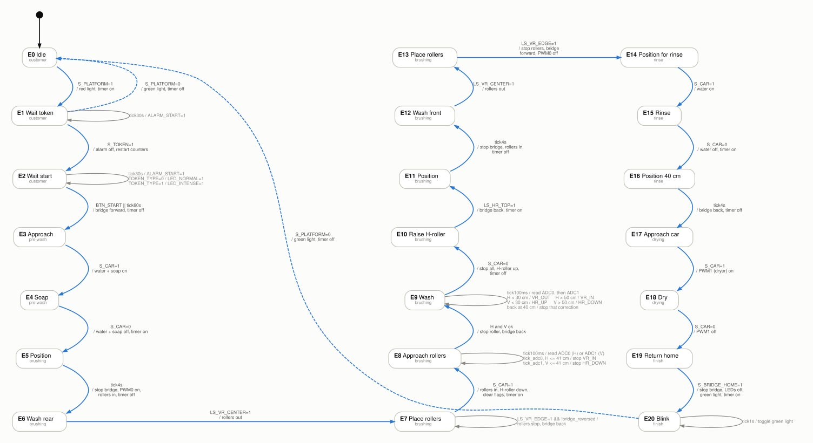
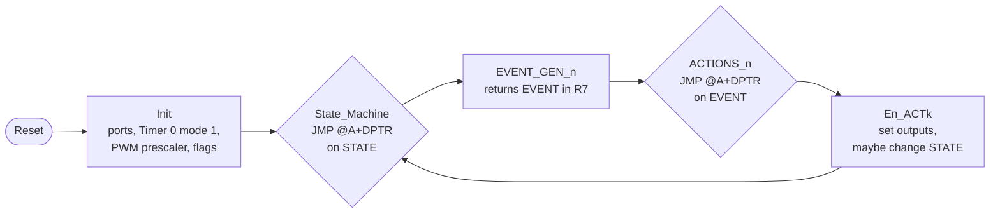
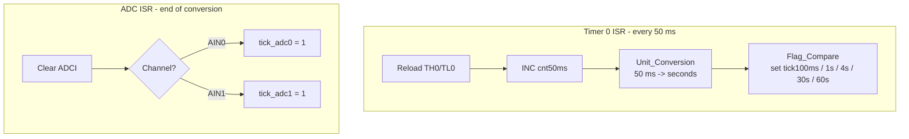

# Design Document — Car Wash Tunnel Controller (80C552)

English technical documentation of the project. It is a translation of the original
Basque lab report ([`original-basque/Final_Report_Basque.pdf`](original-basque/Final_Report_Basque.pdf)),
checked line by line against the final source code in [`src/carwash_controller.asm`](../src/carwash_controller.asm).
Where the report and the code differ, this document describes **what the code does**, and the
difference is pointed out in a note. It describes **version 1.1**, which fixes the bugs found while
translating the original code (see [`CHANGELOG.md`](../CHANGELOG.md)). The behaviour described
here is checked automatically by the simulator and tests in [`tools/sim`](../tools/sim).

**Contents**

1. [Introduction](#1-introduction)
2. [State machine](#2-state-machine)
3. [State, event and action tables](#3-state-event-and-action-tables)
4. [Program structure (flow)](#4-program-structure-flow)
5. [Calculations](#5-calculations)
6. [Annotation: H and V distances](#6-annotation-h-and-v-distances)
7. [Basque → English glossary](#7-basque--english-glossary)

---

## 1. Introduction

The goal of the project was to program the software of an ideal automatic car wash. We used
**Keil µVision2** to write the program and to simulate the whole system on the **80C552**
microcontroller. In the lab sessions, from the start of the project until the delivery date, we
learned what was needed to build the system: **Timer, PWM and ADC**.

As the work progressed, the state diagram and the code changed a lot until they became the
versions shown here. The original report includes both the version submitted at the
intermediate delivery and the final version, with the changes in the final version highlighted.
This repository contains that final version, translated into English, plus the bug fixes of
version 1.1.

---

## 2. State machine

21 states (E0–E20). The diagram shows **every event of every state**, as in the original
hand-drawn diagram:

- **blue arrows**: the event changes the state (label: `event / actions`)
- **grey loops**: the event is handled without leaving the state (alarm, program LEDs, ADC
  readings, closed-loop corrections, blinking)
- **dashed arrows**: return to E0 (the car leaves without a token, or the cycle ends)

<picture>
  <source media="(prefers-color-scheme: dark)" srcset="img/state_machine_dark.svg">
  
</picture>

The process itself is sequential, because a car wash always runs the same steps in the same
order. The decisions happen *inside* the states: E1 and E2 react to the platform, token,
button and timeouts, and E8 and E9 run the closed-loop control on the two ADC readings. The
tables in section 3 list every event with its priority.

The diagram is generated from [`tools/make_state_diagram.py`](../tools/make_state_diagram.py)
(Graphviz).

The original hand-drawn diagram (Basque) is in
[`original-basque/State_Diagram_Basque.pdf`](original-basque/State_Diagram_Basque.pdf).

---

## 3. State, event and action tables

Events are listed **in priority order**: the event generator of each state (`EVENT_GEN_n`) checks
them from top to bottom and returns the first one that is true. Event 0 is always "nothing
happened" and its action is a plain `RET`.

ADC thresholds: `0x4D` = 30 cm, `0x66` = 40 cm, `0x69` ≈ 41 cm, `0x80` = 50 cm (see [5.2](#52-adc)).

### E0 — Idle

| # | Event | Action | Next |
|---|-------|--------|------|
| 1 | `S_PLATFORM = 1` (car on the platform) | Red light on, green light off, start Timer 0 | E1 |

### E1 — Wait for token

| # | Event | Action | Next |
|---|-------|--------|------|
| 3 | `S_PLATFORM = 0` (car left) | Green light on, red off, alarm off, stop Timer 0 | E0 |
| 2 | `tick30s` (30 s without token) | `ALARM_START = 1` | E1 |
| 1 | `S_TOKEN = 1` | Alarm off, clear `tick30s` / `tick60s`, restart the counters so that the 30 s / 60 s of E2 are measured from the token | E2 |

### E2 — Wait for start

| # | Event | Action | Next |
|---|-------|--------|------|
| 1 | `tick60s` | Bridge forward, alarm off, stop Timer 0 | E3 |
| 0 | `tick30s` | `ALARM_START = 1` | E2 |
| 1 | `BTN_START = 1` | Bridge forward, alarm off, stop Timer 0 | E3 |
| 2 | `TOKEN_TYPE = 0` | `LED_NORMAL = 1` (normal program) | E2 |
| 3 | `TOKEN_TYPE = 1` | `LED_INTENSE = 1` (intense program) | E2 |

### E3 — Approach

| # | Event | Action | Next |
|---|-------|--------|------|
| 1 | `S_CAR = 1` | Water and soap valves on | E4 |

### E4 — Soap

| # | Event | Action | Next |
|---|-------|--------|------|
| 1 | `S_CAR = 0` | Water and soap off, start Timer 0 | E5 |

### E5 — Position

| # | Event | Action | Next |
|---|-------|--------|------|
| 1 | `tick4s` | Program PWM0 (roller motor), stop bridge, vertical rollers in, stop Timer 0 | E6 |

### E6 — Wash rear

| # | Event | Action | Next |
|---|-------|--------|------|
| 1 | `LS_VR_CENTER = 1` | Vertical rollers: stop moving in, start moving out | E7 |

### E7 — Place rollers

| # | Event | Action | Next |
|---|-------|--------|------|
| 2 | `S_CAR = 1` | Vertical rollers in, horizontal roller down, stop bridge, clear `bridge_reversed`, `dist_ok` and `height_ok`, start Timer 0 | E8 |
| 1 | `LS_VR_EDGE = 1` and `bridge_reversed = 0` | Stop rollers, bridge backwards, `bridge_reversed = 1` | E7 |

### E8 — Approach rollers (to 40 cm)

| # | Event | Action | Next |
|---|-------|--------|------|
| 1 | `tick100ms` and `dist_ok = 0` | Request ADC0 (H) | E8 |
| 2 | `tick100ms` and `dist_ok = 1` | Request ADC1 (V) | E8 |
| 3 | `tick_adc0`, H ≤ 0x69, `height_ok = 0` | `dist_ok = 1`, stop vertical rollers, request ADC1 | E8 |
| 4 | `tick_adc0`, H ≤ 0x69, `height_ok = 1` | `dist_ok = 1`, stop vertical rollers, bridge backwards | E9 |
| 2 | `tick_adc0`, H > 0x69, `height_ok = 0` | Request ADC1 | E8 |
| 5 | `tick_adc1`, V ≤ 0x69, `dist_ok = 0` | `height_ok = 1`, stop horizontal roller | E8 |
| 6 | `tick_adc1`, V ≤ 0x69, `dist_ok = 1` | `height_ok = 1`, stop horizontal roller, bridge backwards | E9 |

### E9 — Wash (closed-loop distance tracking)

The rollers are kept between 30 cm and 50 cm from the car. When a limit is crossed, the roller
moves towards 40 cm and the `*_ON` flag remembers that a correction is in progress, so the next
reading only checks whether 40 cm has been reached (hysteresis).

| # | Event | Action | Next |
|---|-------|--------|------|
| 9 | `S_CAR = 0` (end of car) | Stop bridge, stop all rollers, horizontal roller up, clear the `*_ON` flags, stop Timer 0 | E10 |
| 1 | `tick100ms` | Request ADC0 | E9 |
| 2 | `tick_adc0`, H < 30 cm | `VR_OUT_ON = 1`, rollers out, request ADC1 | E9 |
| 3 | `tick_adc0`, H > 50 cm | `VR_IN_ON = 1`, rollers in, request ADC1 | E9 |
| 4 | `tick_adc0`, `VR_OUT_ON = 1`, H ≥ 40 cm | `VR_OUT_ON = 0`, stop rollers out, request ADC1 | E9 |
| 5 | `tick_adc0`, `VR_IN_ON = 1`, H ≤ 40 cm | `VR_IN_ON = 0`, stop rollers in, request ADC1 | E9 |
| 11 | `tick_adc0`, any other case (H in range, or correction still running) | Request ADC1 | E9 |
| 6 | `tick_adc1`, V < 30 cm | `HR_UP_ON = 1`, roller up | E9 |
| 7 | `tick_adc1`, V > 50 cm | `HR_DOWN_ON = 1`, roller down | E9 |
| 10 | `tick_adc1`, `HR_UP_ON = 1`, V ≥ 40 cm | `HR_UP_ON = 0`, stop roller up | E9 |
| 8 | `tick_adc1`, `HR_DOWN_ON = 1`, V ≤ 40 cm | `HR_DOWN_ON = 0`, stop roller down | E9 |

Every 100 ms both channels are read: ADC0 first, then ADC1 when the ADC0 conversion finishes.

> Notes: the original report table lists event 10 as `tick_adc0 && UP_PIZTU`; in the code it is
> handled on `tick_adc1` (the V channel). Event 11 is new in version 1.1: before, ADC1 was only
> read when H needed a correction, so the height of the horizontal roller was not controlled while
> the side distance was correct.

### E10 – E20

| State | Event | Action | Next |
|-------|-------|--------|------|
| E10 Raise H-roller | `LS_HR_TOP = 1` | Bridge backwards, stop roller up, start Timer 0 | E11 |
| E11 Position | `tick4s` | Stop bridge, vertical rollers in, stop Timer 0 | E12 |
| E12 Wash front | `LS_VR_CENTER = 1` | Rollers: stop in, start out | E13 |
| E13 Place rollers | `LS_VR_EDGE = 1` | Stop rollers, bridge forward, PWM0 (roller motor) off | E14 |
| E14 Position for rinse | `S_CAR = 1` | Water on | E15 |
| E15 Rinse | `S_CAR = 0` | Water off, start Timer 0 | E16 |
| E16 Position 40 cm | `tick4s` | Bridge: stop forward, start backwards; stop Timer 0 | E17 |
| E17 Approach car | `S_CAR = 1` | Program PWM1 (air dryer) | E18 |
| E18 Dry | `S_CAR = 0` | PWM1 off | E19 |
| E19 Return home | `S_BRIDGE_HOME = 1` | Start Timer 0, stop bridge, program LEDs off, red off, green on | E20 |
| E20 Blink | `tick1s` | Restart Timer 0 counters, toggle green light | E20 |
| E20 Blink | `S_PLATFORM = 0` | Green on, red off, stop Timer 0 | E0 |

---

## 4. Program structure (flow)

The original report contains hand-drawn flowcharts of the main loop, the interrupt routines and
one event generator. They are summarised here.

### 4.1 Main program (main loop and state machine)



Every state uses exactly the same three-part pattern:

```asm
E5_Position:
	ACALL	EVENT_GEN_5		; 1. evaluate inputs -> EVENT (R7)
	MOV	A,EVENT
	RL	A			; AJMP is 2 bytes -> index x 2
	MOV	DPTR,#ACTIONS_5
	JMP	@A+DPTR			; 2. jump to the action for this event
ACTIONS_5:
	AJMP	E5_ACT0			; event 0: nothing
	AJMP	E5_ACT1			; event 1: tick4s
```

### 4.2 Interrupt routines



ISRs only set flags; all decisions are taken in the main loop by the event generators. This keeps
the interrupt routines short and the timing predictable.

Tick generation (version 1.1): `cnt50ms` counts 0–19 and wraps every second, incrementing `cnt1s`.
`tick100ms` is set on every even value of `cnt50ms`, `tick1s` on every wrap, and `tick4s`,
`tick30s` and `tick60s` once, when `cnt1s` reaches 4, 30 and 60. `Timer_Start` always clears the
counters, so every delay is measured from the moment the timer is started.

---

## 5. Calculations

### 5.1 Timer

Timer 0 is used to measure time. With F<sub>osc</sub> = 12 MHz and the fixed ÷12 prescaler of the
8051 core, one count lasts 1 µs:

$$\text{counts} = \frac{T}{T_{osc}\cdot pre} = \frac{T\cdot F_{osc}}{pre}$$

For 100 ms: 100·10⁻³ · 12·10⁶ / 12 = 100 000 counts, which does not fit in 16 bits, so we use
2 × 50 000 → **50 ms** per interrupt:

$$2^{16} - 50\,000 = 15\,536 = \text{0x3CB0} \;\Rightarrow\; TH0 = \text{0x3C},\; TL0 = \text{0xB0}$$

To get one second: 1 s = 1000 ms = **20 × 50 ms**. Counting 50 ms twenty times gives one second,
and from that the 1 s, 4 s, 30 s and 60 s ticks are built.

> Note: in the original code the comparison was written `MOV A,0x14` (the content of RAM address
> 0x14) instead of `MOV A,#0x14` (the number 20). The seconds counter therefore only advanced every
> 256 × 50 ms = 12.8 s. Version 1.1 fixes this.

### 5.2 ADC

The distance sensors give **50 mV/cm** and the ADC uses V<sub>ref−</sub> = 0 V, V<sub>ref+</sub> = 5 V.
Example for 30 cm (40 cm and 50 cm are computed the same way):

$$V_{in} = \frac{50\,\text{mV}}{1\,\text{cm}}\times(30\,\text{cm}-0\,\text{cm}) = 1.5\,\text{V}$$

$$DIG = 2^8\times\frac{V_{in}-V_{ref-}}{V_{ref+}-V_{ref-}} = 2^8\times\frac{1.5-0}{5-0} = 76.8 \rightarrow 77 = \text{0x4D}$$

| Distance | 30 cm | 40 cm | 50 cm |
|----------|-------|-------|-------|
| Voltage  | 1.5 V | 2.0 V | 2.5 V |
| Digital  | 0x4D  | 0x66  | 0x80  |

State E8 uses `0x69` (105 → ≈ 2.05 V → **≈ 41 cm**) as the "close enough" limit, as drawn in the
state diagram (`ADC < 41`).

### 5.3 PWM

First the prescaler PWMP must be computed so that the PWM runs at the right frequency for the
oscillator. Data: F<sub>osc</sub> = 12 MHz, F<sub>PWM</sub> = 1 kHz.

$$PWMP = \frac{F_{osc}}{2\times255\times F_{PWM}} - 1$$

$$PWMP = \frac{12\,\text{MHz}}{2\times255\times1\,\text{kHz}} - 1 = 23.53 - 1 = 22.53 \rightarrow 23 = \text{0x17}$$

With PWMP = 0x17 the real frequency is 12 MHz / (2 · 255 · 24) ≈ **980 Hz**.

> Note: the original report rounded 23.53 to 24 *before* subtracting 1 and used 0x18
> (≈ 941 Hz). Version 1.1 uses 0x17, the value closest to 1 kHz.

Duty cycle (80C552):

$$D = \frac{255 - PWMx}{255} \;\Rightarrow\; PWMx = 255\,(1 - D)$$

| Duty | PWMx | Hex |
|------|------|-----|
| 0 % (off) | 255 | 0xFF |
| 50 % | 127.5 → 128 | 0x80 |
| 85 % | 38.25 → 38 | 0x26 |
| 100 % | 0 | 0x00 |

Values loaded by the firmware:

| Output | Normal program (`TOKEN_TYPE = 0`) | Intense program (`TOKEN_TYPE = 1`) |
|--------|-----------------------------------|------------------------------------|
| PWM0 — roller motor | 0x80 (50 %) | 0x00 (100 %) |
| PWM1 — air dryer    | 0x80 (50 %) | 0x26 (85 %) |

> Note: these are the values given in the report's data section (PWM0 = 50 % / 100 %,
> PWM1 = 50 % / 85 %). The original code used 50 % / 50 % for PWM0 and 85 % / 100 % for PWM1;
> version 1.1 follows the report.

At start-up PWMP is set to 0x17 and both PWM outputs to 0xFF (off); each state then writes the
duty value it needs.

---

## 6. Annotation: H and V distances

Our **"H"** refers to the **vertical rollers** and their *horizontal* distance to the car, and our
**"V"** refers to the **horizontal roller** and its *vertical* distance to the car. In other words,
in the simulation **AIN0** moves the ADC value of the vertical rollers and **AIN1** moves the ADC
value of the horizontal roller. (We were asked to state this in an annotation instead of changing
the names.)

---

## 7. Basque → English glossary

The original report and diagrams use the Basque names. This table maps them to the names used
in the English source code.

### I/O signals

| Original | English | Pin | Dir. | Meaning |
|----------|---------|-----|------|---------|
| `SEM_BERDEA` | `LIGHT_GREEN` | P0.0 | out | Traffic light, green |
| `SEM_GORRIA` | `LIGHT_RED` | P0.1 | out | Traffic light, red |
| `S_PLAT` | `S_PLATFORM` | P0.2 | in | Car on the entry platform |
| `FICHA_TIPO` | `TOKEN_TYPE` | P0.3 | in | Token type (0 normal, 1 intense) |
| `S_FICHA` | `S_TOKEN` | P0.4 | in | Token inserted |
| `P_START` | `BTN_START` | P0.5 | in | START push-button |
| `AL_START` | `ALARM_START` | P0.6 | out | "Press START" alarm |
| `BPOS_START` | `S_BRIDGE_HOME` | P0.7 | in | Bridge at home position |
| `BMOV_FRONT` | `BRIDGE_FWD` | P1.0 | out | Bridge moves forward |
| `BMOV_BACK` | `BRIDGE_BACK` | P1.1 | out | Bridge moves backward |
| `FC_RH_TOP` | `LS_HR_TOP` | P1.2 | in | Horizontal roller top limit switch |
| `UP` | `HR_UP` | P1.3 | out | Horizontal roller up |
| `Down` | `HR_DOWN` | P1.4 | out | Horizontal roller down |
| `Out` | `VR_OUT` | P1.6 | out | Vertical rollers out |
| `IN` | `VR_IN` | P1.7 | out | Vertical rollers in |
| `EV_URA` | `VALVE_WATER` | P2.0 | out | Water solenoid valve |
| `EV_XABOIA` | `VALVE_SOAP` | P2.1 | out | Soap solenoid valve |
| `S_CAR` | `S_CAR` | P2.3 | in | Car detected under the bridge |
| `FC_RV_CENTRO` | `LS_VR_CENTER` | P2.4 | in | Vertical rollers limit switch, centre |
| `FC_RV_BORDE` | `LS_VR_EDGE` | P2.5 | in | Vertical rollers limit switch, edge |
| `LED_LNOR` | `LED_NORMAL` | P2.6 | out | Normal program LED |
| `LED_LINT` | `LED_INTENSE` | P2.7 | out | Intense program LED |
| — | — | P1.5, P2.2 | — | Not used |

### Variables, flags and routines

| Original | English | Original | English |
|----------|---------|----------|---------|
| `EGOERA` (R6) | `STATE` | `GERTAERA` (R7) | `EVENT` |
| `kont50ms` | `cnt50ms` | `kont1s` | `cnt1s` |
| `dist_egokia` | `dist_ok` | `alt_egokia` | `height_ok` |
| `IN_PIZTU` / `OUT_PIZTU` | `VR_IN_ON` / `VR_OUT_ON` | `UP_PIZTU` / `DOWN_PIZTU` | `HR_UP_ON` / `HR_DOWN_ON` |
| `Hasiera` / `Begizta` | `Main` / `Main_Loop` | `Hasieraketak` | `Init` |
| `Egoera_Makina` / `Egoera_Zerrenda` | `State_Machine` / `State_Table` | `GERTAERA_SORGAILU_n` | `EVENT_GEN_n` |
| `EKINTZAK_n` | `ACTIONS_n` | `En_EKk` | `En_ACTk` |
| `FLAG0` | `bridge_reversed` | | |
| `Timer_Hasieratu` | `Timer_Start` | `Timer_Amatatu` | `Timer_Stop` |
| `Timer_BirHasieratu` | `Timer_Restart` | `ADC_Hasieratu` | `ADC_Start` |
| `Unitate_Bihurketa` | `Unit_Conversion` | `Flag_Konp` | `Flag_Compare` |
| `PWMx_Prog` / `PWMx_Itzali` | `PWMx_On` / `PWMx_Off` | `PWMx_INT` | `PWMx_Intense` |

> In state E2 the original action labels started at `E2_EK1`; they are now `E2_ACT0`…`E2_ACT3`
> so that, like every other state, the action number equals the event number.

### States

| # | Original | English | # | Original | English |
|---|----------|---------|---|----------|---------|
| E0 | Itxoin | Idle | E11 | Kokapen | Position |
| E1 | Fitxa itxaroten | Wait token | E12 | Aurrean garbitu | Wash front |
| E2 | Hasi itxaroten | Wait start | E13 | Arrabolak kokatu | Place rollers |
| E3 | Hurbildu | Approach | E14 | Kokatu | Position for rinse |
| E4 | Xaboia | Soap | E15 | Ureztatu | Rinse |
| E5 | Kokapen | Position | E16 | Kokatu 40cm | Position 40 cm |
| E6 | Atzean garbitu | Wash rear | E17 | Kotxera hurbildu | Approach car |
| E7 | Arrabolak kokatu | Place rollers | E18 | Aireztatu | Dry |
| E8 | Hurbildu | Approach rollers | E19 | Kokatu hasieran | Return home |
| E9 | Garbitu | Wash | E20 | Keinuka | Blink |
| E10 | Horizontala kokatu | Raise H-roller | | | |
